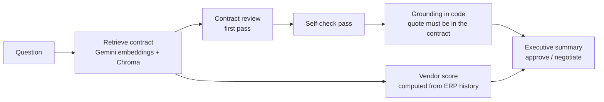

# Procurement Intelligence Agent

A LangGraph workflow on Gemini that reviews a supply contract for terms that
work against the buyer, scores the vendor from ERP history, and gives a
procurement manager a short Thai summary with a recommendation: approve, or
negotiate first. A second agent answers ERP questions (vendor master, budget,
PO status) by Gemini function calling, and the same ERP tools are served over
MCP.

> All contracts, vendors and ERP records are synthetic, generated for this
> project.

## The problem

Before a contract goes for approval, a buyer has to read it for terms that
hurt the company (full prepayment, automatic renewal, a vendor's right to
raise prices, a liability cap that is too low) and check the vendor's record.
Managers then want two or three sentences and a clear recommendation, not the
whole contract.

## How it works



- **Fixed risk types, quoted clauses.** The model picks from eight defined
  risk types (`procurement_agent/risks.py`) and must copy the clause it relied
  on, word for word. Output is JSON with a schema, so it can be scored.
- **Grounding in code.** Any risk whose quoted clause is not in the contract is
  dropped before the summary sees it, and kept in the result for review.
- **Self-check pass.** The model gets the contract and its first list again,
  removes what the text does not support and adds what it missed. It costs one
  more call; `--no-self-check` skips it and the evaluation measures both.
- **The vendor score is code, not a prompt.** Late-delivery rate, quality
  claims, tenure and status give a 1 to 10 score with the reasons attached, so
  the same history always gets the same score.
- **Parallel branches.** The contract review and the vendor score run side by
  side after retrieval; the summary waits for both.
- **Tracing.** Every model call records latency, input and output tokens
  (thinking tokens included, since they are billed as output) and estimated
  cost. A run reports wall-clock time separately from the sum of node times.

ERP questions take a different path: Gemini chooses `get_vendor_info`,
`check_budget` or `get_po_status` by native function calling, code runs the
tool, and Gemini words the answer from the tool result only.
`python -m procurement_agent.erp.mcp_server` serves the same three tools to
any MCP client.

## Run it

Requires Python 3.11 or newer.

```bash
python -m venv .venv && source .venv/bin/activate
pip install -e ".[dev,app]"

# Gemini API key, or Vertex AI (see below)
export GEMINI_API_KEY=your-key

python -m procurement_agent "สัญญาคอมพิวเตอร์โน้ตบุ๊กมีความเสี่ยงอะไรบ้าง ควรอนุมัติไหม" --trace
python -m procurement_agent.erp "ฝ่ายไอทีมีงบประมาณเหลืออีกเท่าไหร่"
streamlit run app.py
```

For Vertex AI instead of an API key:

```bash
gcloud auth application-default login
export GOOGLE_CLOUD_PROJECT=your-project-id
export GOOGLE_CLOUD_LOCATION=us-central1   # optional
```

| Variable | Default | |
| --- | --- | --- |
| `PROCUREMENT_AGENT_MODEL` | `gemini-2.5-flash` | any Gemini model |
| `PROCUREMENT_AGENT_EMBEDDING_MODEL` | `gemini-embedding-001` | |
| `PROCUREMENT_AGENT_THINKING_BUDGET` | `0` on Gemini 2.5 Flash, model default otherwise | empty string = model default |

Tests use a scripted stand-in for Gemini and need no key:

```bash
pytest
```

## Evaluation

```bash
python -m procurement_agent.evaluate --self-check both   # writes reports/eval.json
python -m procurement_agent.evaluate --baseline-only     # no API key needed
```

Sixteen labelled contracts are used. The prompts, the risk definitions and a
keyword baseline were written against the first ten (`C001` to `C010`). The
other six (`H001` to `H006`) were written afterwards in different wording,
such as "lessee" and "lessor" instead of buyer and seller, or durations
spelled out in words, and are reported separately.

The evaluation measures:

- retrieval: the right contract ranked first, two phrasings per contract
- risk detection: precision and recall of risk types against the labels
- grounding: quoted clauses that were not in the contract and were dropped
- recommendation: approve or negotiate against the expected decision, which
  is "negotiate" when the contract has a labelled risk or the vendor scores 7
  or more
- ERP tool choice: the right tool and arguments, over eight questions
- latency per question (wall clock), model calls, tokens and cost

The keyword baseline shows why the held-out set matters:

| Keyword baseline | Precision | Recall |
| --- | --- | --- |
| Contracts the rules were written for (10) | 78% | 100% |
| Held-out contracts (6) | 14% | 12% |

## Repository layout

```
procurement_agent/
  graph.py            LangGraph workflow: retrieve, review and score in parallel, summarize
  contract_agent.py   First pass, self-check pass, grounding
  risks.py            Risk types, output schema, grounding, keyword baseline
  vendor_score.py     Vendor risk score from ERP history
  retrieval.py        Gemini embeddings in a Chroma collection
  llm.py              The only module that calls Gemini (retries, timeouts, tracing)
  tracing.py          Latency, tokens and cost per call
  evaluate.py         Evaluation and report
  sample_data.py      Synthetic contracts with labels, vendor history, ERP records
  erp/                ERP tools, function-calling agent, MCP server
app.py                Streamlit UI
tests/                Unit and end-to-end tests with a scripted model
```

## Limitations

- Sixteen short synthetic contracts in Thai, each with four or five clauses.
  Real contracts are longer, arrive as PDFs and need a document parser and
  clause splitting before this step.
- The risk labels are one reviewer's reading of the definitions; some
  categories (what counts as a "low" liability cap) are judgment calls.
- Retrieval returns one contract per question. A question about several
  contracts, or about none, is not handled.
- The ERP tools read in-memory records. A real deployment would call the ERP
  with a read-only account for the agent.
